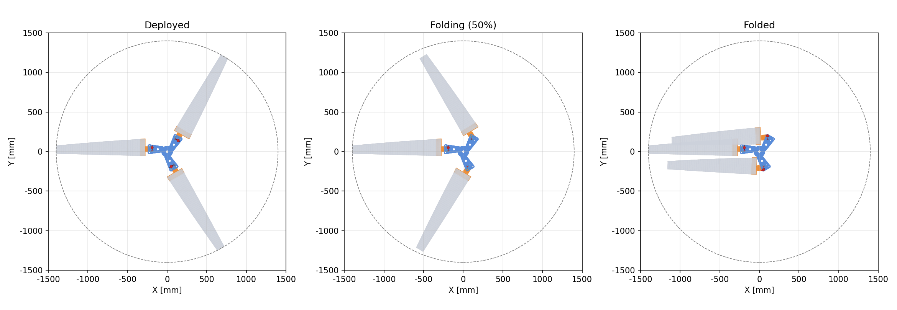
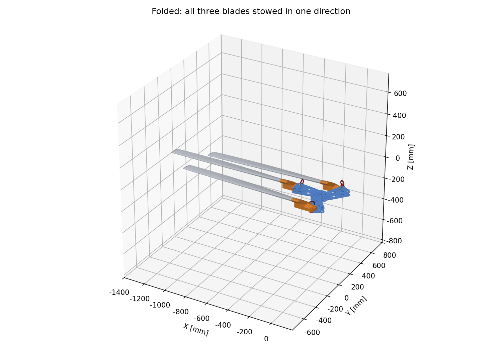

# Three-Blade Co-Directional Folding Hub

Folding hub for a three-blade rotor (tip radius 1.4 m, operating speed 982 rpm). All three blades fold to the same side, reducing the plan area from 6.16 m² to 0.71 m². Mechanism mass is 6.10 kg without blades.



## Mechanism

- Upper and lower 7075-T6 plates with a centre spacer ring; the three arms are identical.
- The blade grip tongue sits between the plates and is located by two vertical 16 mm pins: a pivot bolt and a quick-release lock pin.
- Each arm has two flight holes and two parking holes. Blade A stays in place, blade B rotates +122 deg about its leading-edge pin, blade C rotates -122 deg about its trailing-edge pin, and the lock pins go into the parking holes.
- The hinge plane is 47 mm below the pitch axis, where the centrifugal moment cancels the thrust moment, so the steady flap moment at the hinge is zero in hover.



## Repository layout

| Path | Content |
|---|---|
| `blade_single.SLDPRT` | Original blade model |
| `blade_rebuilt_mm.stl` | Blade mesh recovered from the SLDPRT |
| `CAD/` | Part STEP files and FreeCAD assembly |
| `figures/` | Figures |
| `src/` | Analysis and CAD scripts with intermediate data |
| `design_report.docx` | Design report |

The deployed and folded assembly STEP files (about 58 MB each) are not tracked. Generate them with `fc_build.py` or download them from Releases.

## Requirements

- Python 3.10+ with numpy, scipy, matplotlib, python-docx
- FreeCAD 1.1 (`freecadcmd`)

```
pip install numpy scipy matplotlib python-docx
```

## Workflow

Run from `src/`:

| Step | Command | Output |
|---|---|---|
| 1 | `python sldprt_unpack.py` | `../_extract/` |
| 2 | `python extract_mesh.py` | `pts_raw.npy` |
| 3 | `python blade_geom.py` | `../blade_rebuilt_mm.stl`, `sections.npy` |
| 4 | `python loads.py` | `loads_base.json` |
| 5 | `python fold_kinematics.py` | `layout_opt.json` |
| 6 | `python sizing.py` | `sizing.json` |
| 7 | `python pareto.py` | `pareto.json` |
| 8 | `python final_design.py` | `design.json` |
| 9 | `python sizing_ref.py` | `sizing_ref.json` |
| 10 | `freecadcmd fc_build.py` | `../CAD/`, `fc_report.json`, `stl/` |
| 11 | `python clearance.py` | `clearance.json` |
| 12 | `python render.py asm plots` | `../figures/` |
| 13 | `python report_simple.py` | `../design_report.docx` |

Result files of every step are included in `src/`, so any step can be run on its own.

## Results

| Item | Value |
|---|---|
| Hover thrust / torque / power at 982 rpm | 1932 N / 263 N·m / 27.0 kW |
| Design check speed | 1080 rpm |
| Hinge radius / pin spacing / pin diameter | 190 / 40 / 16 mm |
| Folded envelope | 1566 x 605 x 128 mm |
| Minimum clearance during folding | 7.8 mm |
| Highest utilisation | 0.94 (plate lug fatigue) |

## License

MIT License
